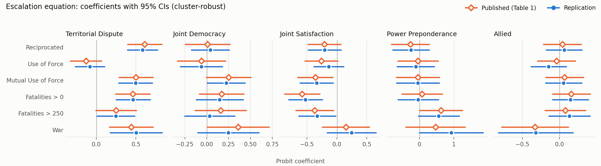

# Replication Report: Braithwaite & Lemke (2011), "Unpacking Escalation"

*Conflict Management and Peace Science* 28(2): 111–123 · DOI [10.1177/0738894210396631](https://doi.org/10.1177/0738894210396631)

## 1. Summary

**The article's core finding replicates.** Territorial disputes significantly raise the probability of escalation under 5 of the 6 escalation measures; the one exception is Use of Force, exactly as in the article. This holds in all 9 specifications estimated, including a version that corrects the data-coding problems found in the original.

| Comparison | Agreement |
|---|---|
| Onset equation (stage 1): sign and significance | **54 / 54** |
| Escalation equation (stage 2): sign and significance | **26 / 30** |
| Selection parameter ρ: sign and significance | **5 / 6** |
| Stage 1 N | 500,225 vs. 499,145 published (+0.2%) |
| Stage 2 N | 1,457 vs. 1,352 published (+7.8%) |
| Highest/lowest pairwise correlation among the measures | Same pairs; 0.776 / 0.136 vs. 0.756 / 0.144 published |

**How agreement is counted:**
- A cell agrees if, where the article reports a significant coefficient, the replication has the same sign and is also significant (p < .10); and where the article reports an insignificant coefficient, the replication is also insignificant.
- The onset equation has 9 variables × 6 models = 54 cells; the escalation equation has 5 variables × 6 models = 30 cells. Constants are excluded from both.

**Two unexpected findings.** Two variables in the original data were almost certainly coded with a Stata missing-value problem (in Stata, a missing value `.` is larger than any number):

1. **Fatalities:** missing fatality levels (−9) were counted as "fatalities > 0" and "fatalities > 250". Evidence: the article reports 294 MIDs with more than 250 deaths, but the entire MID 3.0 dataset contains only 104 such disputes.
2. **Democracy:** Polity's special codes (−66 foreign interruption, −77 interregnum, −88 transition) were counted as democratic. Evidence: of the 8 "jointly democratic warring dyads" the article names, 4 involve at least one state in such a special-code year.

The main specification rebuilds the original data using these inferred codings. After correcting both, the territorial-dispute result **still holds and is stronger**, but the article's finding that **joint democracy raises the probability of escalation to war disappears** (see Section 6).



---

## 2. Original specification (from the full text)

| Item | Article | Replication |
|---|---|---|
| Unit of analysis | Non-directed dyad-years, 1919–1995 | All pairs of states in COW system membership 2004.1 |
| Stage 1 dependent variable | MID Onset: whether a new bilateral MID begins in the dyad-year | MID v3.02; "bilateral on day one" = exactly one originator on each side (`orig==1`) |
| Stage 2 dependent variables (6) | Reciprocated, Use of Force, Mutual Use of Force, Fatalities > 0, Fatalities > 250, War | `recip==1`; `hostlev≥4`; each side's highest `hostlev`≥4; `fatality>0`; `fatality>3`; `hostlev==5` |
| Stage 1 only (exclusion restrictions) | Contiguity, Rivalry, Both Minors | COW Direct Contiguity v3.1 (land or ≤150 miles of water); Thompson strategic rivalries; COW major powers 2004 |
| In both stages | Joint Democracy, Joint Satisfaction, Power Preponderance, Defense Pact | Polity IV (p4v2009) `democ≥6`; both states have positive alliance-portfolio τ-b with the system leader (UK before 1946, US after); stronger state's share of dyadic CINC (NMC v4.0); defense pact in Alliances v3.03 |
| Territory | Stage 1: Huth & Allee territorial claims; Stage 2: MID issue type | Huth–Allee status-quo data (Harvard Dataverse); `revtype1/2==1` for either originator |
| Time dependence | Carter–Signorino cubic polynomial | Years since the last MID onset, plus its square and cube |
| Estimator | Censored probit (Heckman selection), standard errors clustered by dyad | `heckprob` implemented in Python (maximum likelihood with cluster-robust sandwich standard errors) |

All data use **the versions current when the article was published (2011)** wherever possible; versions no longer on the COW website were recovered from the Wayback Machine.

---

## 3. Table 1 replication (main specification)

Each cell shows **replication (published)**; ⚠️ marks a cell whose sign or significance differs from the article. Significance: * p < .10, ** p < .05, *** p < .01.

| Variable | Reciprocated | Use of Force | Mutual Force | Fatal>0 | Fatal>250 | War |
|---|---|---|---|---|---|---|
| Onset: Contiguity | 1.06*** (1.06***) | 1.06*** (1.06***) | 1.05*** (1.06***) | 1.06*** (1.06***) | 1.06*** (1.06***) | 1.05*** (1.06***) |
| Onset: Rivalry | 0.81*** (0.80***) | 0.81*** (0.80***) | 0.81*** (0.80***) | 0.81*** (0.80***) | 0.81*** (0.79***) | 0.81*** (0.79***) |
| Onset: Both Minors | -0.75*** (-0.71***) | -0.76*** (-0.71***) | -0.75*** (-0.70***) | -0.75*** (-0.71***) | -0.76*** (-0.71***) | -0.77*** (-0.72***) |
| Onset: Joint Democracy | -0.16*** (-0.21***) | -0.16*** (-0.21***) | -0.16*** (-0.21***) | -0.16*** (-0.21***) | -0.16*** (-0.21***) | -0.16*** (-0.21***) |
| Onset: Joint Satisfaction | 0.004 (-0.001) | 0.002 (-0.003) | 0.004 (-0.001) | 0.005 (-0.001) | 0.004 (-0.003) | 0.001 (-0.004) |
| Onset: Territorial Claim | 0.49*** (0.50***) | 0.49*** (0.51***) | 0.49*** (0.50***) | 0.49*** (0.50***) | 0.49*** (0.50***) | 0.49*** (0.51***) |
| Onset: Power Preponderance | -0.37** (-0.27*) | -0.38*** (-0.29*) | -0.36** (-0.27*) | -0.37** (-0.27*) | -0.37*** (-0.29*) | -0.38*** (-0.29*) |
| Onset: Allied | -0.029 (-0.003) | -0.029 (-0.003) | -0.028 (-0.004) | -0.029 (-0.004) | -0.029 (-0.003) | -0.026 (-0.002) |
| Onset: Peace Years | -0.04*** (-0.03***) | -0.04*** (-0.03***) | -0.04*** (-0.03***) | -0.04*** (-0.03***) | -0.04*** (-0.03***) | -0.04*** (-0.03***) |
| Esc.: Joint Democracy | 0.04 (0.01) | -0.06 (-0.06) | 0.22** (0.25*) | 0.15 (0.17) | 0.03 (0.16) | 0.25 (0.36**) ⚠️ |
| **Esc.: Territorial Dispute** | **0.58*** (0.61***)** | **-0.08 (-0.13)** | **0.49*** (0.50***)** | **0.46*** (0.46***)** | **0.25** (0.25**)** | **0.50*** (0.44***)** |
| Esc.: Joint Satisfaction | -0.20 (-0.21*) ⚠️ | -0.14 (-0.26*) ⚠️ | -0.34** (-0.36**) | -0.52*** (-0.58***) | -0.33** (-0.37**) | 0.25 (0.15) |
| Esc.: Power Preponderance | -0.24 (-0.26) | -0.11 (-0.04) | -0.04 (-0.04) | -0.03 (0.08) | 0.56* (0.63**) | 0.93* (0.47) ⚠️ |
| Esc.: Allied | 0.06 (0.04) | -0.14 (-0.04) | 0.06 (0.07) | 0.15 (0.16) | 0.13 (0.08) | -0.32 (-0.33) |
| ρ | -0.32*** (-0.33***) | 0.11** (0.07) ⚠️ | -0.27*** (-0.30***) | -0.27*** (-0.30***) | -0.24*** (-0.23***) | -0.37*** (-0.26***) |
| Model χ² (df=5) | 38.23*** (35.97***) | 7.54 (9.32*) | 27.77*** (28.32***) | 28.22*** (27.30***) | 11.05* (12.18**) | 19.31*** (17.25***) |

Full results, including standard errors and p-values, are in [output/table1.csv](output/table1.csv) and [output/table1_comparison.csv](output/table1_comparison.csv).

### Cells that disagree, and likely reasons

| Cell | Replication | Published | Analysis |
|---|---|---|---|
| Reciprocated: Joint Satisfaction | −0.20 (SE 0.14) | −0.21* (SE 0.14) | Coefficient and standard error are nearly identical. From the article's own numbers, z = 0.21/0.14 = 1.5 and the two-tailed p ≈ 0.13, so the cell should not carry a star. **The published star is inconsistent with the published coefficient and standard error**; a one-tailed test may have been used. |
| Use of Force: Joint Satisfaction | −0.14 | −0.26* | Same direction; the replicated effect is weaker. |
| War: Joint Democracy | 0.25 (p ≈ 0.17) | 0.36** | Same direction. The replication sample contains 7 of the 8 jointly democratic warring dyads the article names. The missing one is Britain vs. Finland (1941), which has hostlev 4 in MID 3.02, not war. The result rests on about 8 cases and is very fragile, as the article itself acknowledges. |
| War: Power Preponderance | 0.93* | 0.47 | Same direction; with only about 50 wars, this coefficient is unstable. |
| Use of Force: ρ | 0.11** | 0.07 | Same direction and both small. The article also notes that Use of Force is the one model that "performs differently." |

---

## 4. Evidence for the two coding problems

### 4.1 Fatalities: missing counted as "has fatalities"

| | Published | Replication: missing = 1 (Stata behavior) | Replication: missing = 0 (correct) |
|---|---|---|---|
| Fatalities > 0 | 536 (28%) | 627 (29%) | 373 (17%) |
| Fatalities > 250 | 294 (15%) | 346 (16%) | 92 (4%) |

Among all 2,331 disputes in MID 3.0, only **104** have `fatality ≥ 4` (more than 250 deaths). The article nonetheless counts 294 among its 1,901 bilateral MIDs, which is only possible if −9 (missing) is included. In Stata, recoding −9 to `.` and then running `gen fat250 = fatality > 3` assigns 1 to every missing value. The main specification uses this coding ([src/build_mids.py](src/build_mids.py)).

### 4.2 Democracy: Polity special codes counted as "democratic"

The article (p. 119) lists 8 "jointly democratic warring dyads." Checked against Polity IV (p4v2009):

| Dyad | Year | Polity `democ` | Jointly democratic under correct coding? |
|---|---|---|---|
| France–Turkey | 1919 | 9 / **−66** | No |
| Greece–Turkey | 1919 | **−66** / **−66** | No |
| Lithuania–Poland | 1920 | 8 / 7 | Yes |
| Britain–Finland | 1941 | 10 / 7 | Yes (but this MID is not a war in MID 3.02) |
| Hungary–Romania | 1944 | **−66** / **−88** | No |
| Cyprus–Turkey | 1974 | 10 / 9 | Yes |
| Greece–Turkey | 1974 | **−88** / 9 | No |
| India–Pakistan | 1993 | 8 / 8 | Yes |

Treating −66, −77, and −88 as missing and then evaluating `democ ≥ 6` under Stata's comparison rules raises the number of jointly democratic warring dyads in the replication sample from 3 to **7**, close to the article's 8. The article itself calls some of these pairings "odd artefacts of the way that our datasets typically code World War II." The main specification uses this coding.

---

## 5. Table 2 (predicted probabilities)

The article describes this table as probabilities "given that a dispute has occurred and holding all covariates at their means." Of the 6 computation methods tried, **conditional probability at the MID-sample means, P(y=1 | s=1) = Φ₂(xβ, zγ, ρ) / Φ(zγ)**, comes closest to the article's baseline row:

| | Reciprocated | Use of Force | Mutual Force | Fatal>0 | Fatal>250 | War |
|---|---|---|---|---|---|---|
| Baseline (replication) | 0.508 | 0.765 | 0.328 | 0.300 | 0.154 | 0.023 |
| Baseline (published) | 0.48 | 0.77 | 0.32 | 0.31 | 0.158 | 0.041 |
| Territorial Dispute 0 → 1 (replication) | .438 → .675 | – | .276 → .467 | .253 → .427 | .137 → .200 | – |
| Territorial Dispute 0 → 1 (published) | .449 → .561 | – | .282 → .387 | .269 → .371 | .138 → .179 | – |

The baseline probabilities and the Territorial Dispute = 0 probabilities match, but the replicated territorial effects are roughly 1.5–2 times larger than published, even though the coefficients are nearly identical. The article may have used simulation (e.g., Clarify) or changed other covariates along with territory; the text does not give enough detail to tell. **Qualitatively the results agree**: territory has the largest effect of any variable. Full results are in [output/table2.csv](output/table2.csv).

---

## 6. Robustness checks

Territorial Dispute coefficients across specifications ([output/territorial_dispute_by_spec.csv](output/territorial_dispute_by_spec.csv)):

| Specification | Recip. | Force | Mutual | Fatal>0 | Fatal>250 | War | Stage 2 agreement |
|---|---|---|---|---|---|---|---|
| Published | 0.61*** | −0.13 | 0.50*** | 0.46*** | 0.25** | 0.44*** | – |
| main (rebuilds original coding) | 0.58*** | −0.08 | 0.49*** | 0.46*** | 0.25** | 0.50*** | 26/30 |
| corrected (both variables coded correctly) | 0.58*** | −0.08 | 0.49*** | 0.54*** | 0.58*** | 0.50*** | 24/30 |
| jd_correct (democracy fixed only) | 0.58*** | −0.08 | 0.49*** | 0.47*** | 0.25** | 0.50*** | 26/30 |
| fatal_strict (fatalities fixed only) | 0.58*** | −0.08 | 0.49*** | 0.54*** | 0.58*** | 0.50*** | 22/30 |
| jd_stata_all (states absent from Polity also count as democratic) | 0.58*** | −0.08 | 0.49*** | 0.46*** | 0.25** | 0.50*** | 25/30 |
| polity2 (democracy defined as polity2 ≥ 6) | 0.59*** | −0.08 | 0.50*** | 0.47*** | 0.25** | 0.50*** | 25/30 |
| contig_24 (contiguity: ≤24 miles of water) | 0.55*** | −0.07 | 0.45*** | 0.42*** | 0.22* | 0.47*** | 26/30 |
| contig_land (contiguity: land only) | 0.51*** | −0.07 | 0.41*** | 0.39*** | 0.21* | 0.42** | 26/30 |
| terr_any_participant (territorial issue raised by any participant) | 0.59*** | −0.08 | 0.50*** | 0.47*** | 0.24** | 0.50*** | 26/30 |

The onset equation agrees 54/54 and ρ agrees 5/6 in every specification.

**Which conclusions survive the data corrections:**
- **Territorial disputes: hold, and are stronger.** After fixing the fatality variable, the coefficient on Fatalities > 250 rises from 0.25 to 0.58.
- **Joint democracy raises the probability of escalation to war: does not hold.** The corrected coefficient is −0.05 (p ≈ 0.82); the published result depends on dyads miscoded as democratic. The positive effect of joint democracy on Mutual Use of Force (0.24**) survives the correction, consistent with the article.
- **Joint satisfaction lowers the probability of Fatalities > 250: does not hold.** The corrected coefficient is +0.08 and insignificant.

---

## 7. Limitations

- **Stage 2 N is 7.8% larger (1,457 vs. 1,352).** MID 3.02 contains 2,165 disputes that are "bilateral on day one" under this definition, versus 1,901 in the article. Three different definitions of "bilateral on day one" were tried and none reproduces the article's count; the article does not give the exact filtering rule. The shares escalating under each measure match the article within 2 percentage points.
- **The war count does not match.** The article reports 104 wars, while at most 99 bilateral MIDs in the replication have `hostlev = 5`. The article may have merged in COW war data separately.
- **Different rivalry data version.** The replication uses the update by Thompson, Sakuwa & Suhas (2021); the article used Thompson (2001).
- **τ-b is computed here.** The article most likely used EUGene. Alliances are coded defense 3, neutrality 2, entente 1, none 0, with each state coded as having a defense pact with itself; this may differ slightly from EUGene.
- **Ambiguous contiguity definition.** The article says "fewer than 125km of water," but COW's contiguity categories have no 125 km threshold. The main specification uses ≤150 miles; the two alternative definitions are robustness checks.
- **Territorial-claim start and end years are approximate.** They are taken as the first and last years each dispute appears in the Huth–Allee status-quo data.
- **No Stata or R cross-check.** Neither is installed on this machine, so the heckprob estimator was implemented in Python. On simulated data it recovers every parameter (|z| < 1.5), and its bivariate normal CDF differs from scipy's by 3e−16. See [src/validate_heckprob.py](src/validate_heckprob.py).

---

## 8. Files and how to run

```
REPLICATION_PLAN.md          Initial replication plan
REPORT.md                    This report
summary.html                 One-page HTML summary
paper/                       Article PDF, extracted text, transcribed Table 1 (table1_published.json)
data/raw/                    Raw data (versions listed in Section 2)
data/clean/                  Generated analysis data
src/build_mids.py            MID processing: bilateral disputes, six escalation measures, territory
src/build_dyadyears.py       Builds the dyad-year frame and merges all covariates
src/heckprob.py              Heckman probit estimator (MLE + cluster-robust standard errors)
src/validate_heckprob.py     Estimator checks
src/estimate.py              Table 1 and Table 2; --spec selects the specification
src/summarize.py             Agreement with the article across specifications
src/make_figure.py           Coefficient comparison figure
run_all.sh                   Runs every step
output/                      All result tables, figures, and logs
```

To run everything (about 15 minutes, mostly the 9 specifications):

```bash
bash run_all.sh
```

Requirements: Python 3.12 with pandas, numpy, scipy, statsmodels, pyreadstat, pyarrow, matplotlib.
